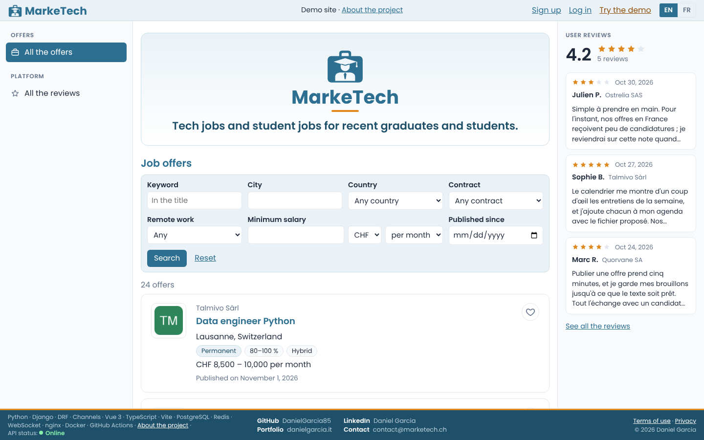
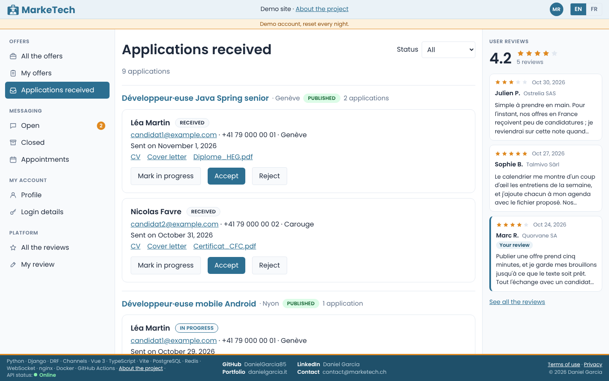
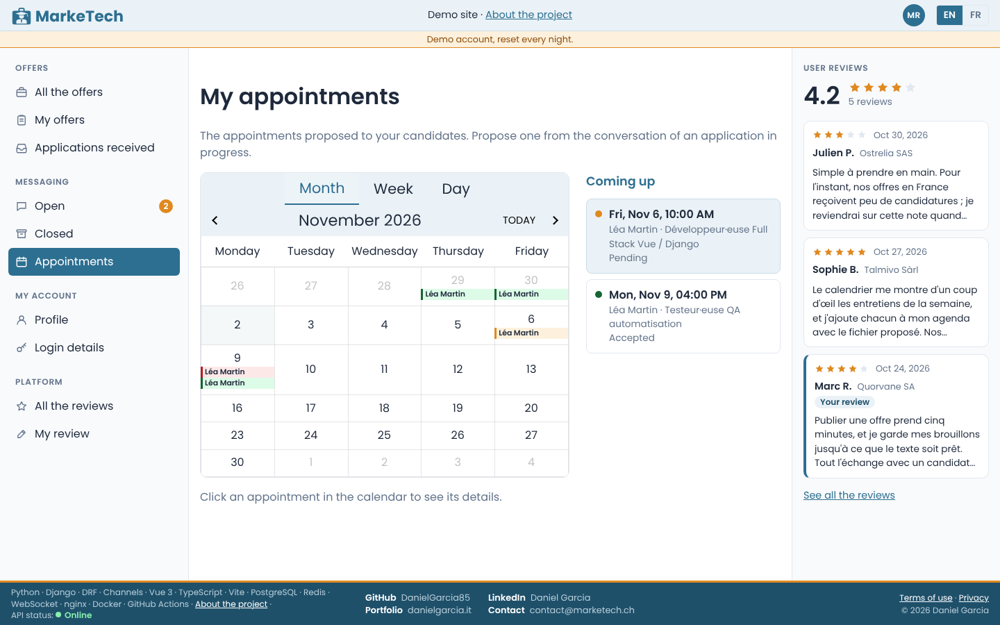
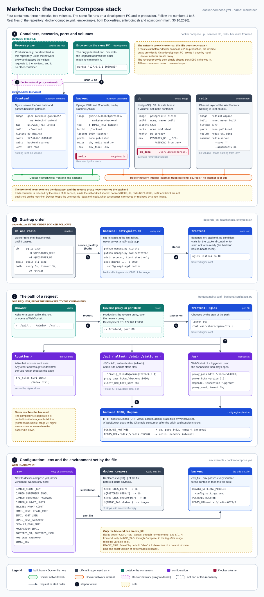
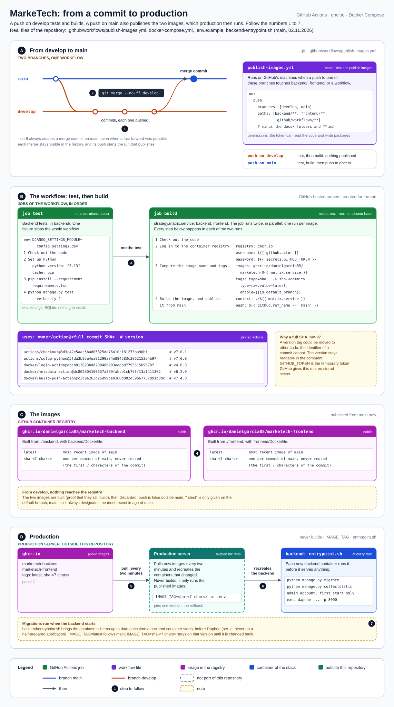

# MarkeTech


A job board for tech and student jobs, aimed at computer science students and recent
graduates. Employers publish offers, candidates apply, and both follow each application through
messages and appointments until the decision.

**Live site: [https://marketech.ch](https://marketech.ch)**, with two demo accounts (candidate
and employer) open to everyone and reset every night.



---

## About the project

The concept and the specifications come from a **team project**: the interschool module 65-41
(HEG Genève, HEG Arc Neuchâtel, HES-SO Valais), spring 2025, run with Scrum by a team of four
students. My part of that deliverable: setting up the environments, sign-up, login (with a
teammate), profiles, access control and the display of offers.

The code in this repository is a **complete rewrite that I did on my own**, without the original
team, with the help of Claude (see [Use of AI](#use-of-ai)). Nothing from the team's code was
copied: the original deliverable only served as specifications. The whole infrastructure layer
(server, Docker, reverse proxy and HTTPS, image publishing, automatic updates, backups, real time)
is an addition of mine that did not exist in the school project.

## Features

- **Job offers**: public list with filters (keyword, city, country, contract, remote work,
  minimum salary, publication date) and pages. Employers write drafts, publish and close them.
- **Applications**: a CV, an optional cover letter and documents from the profile, copied when the
  application is sent; the status (received, in progress, accepted, rejected) is tracked on both
  sides, with its history.
- **Messaging** between the candidate and the employer for every application in progress.
- **Appointments** proposed by the employer, accepted or declined by the candidate, shown in a
  calendar and exportable to any calendar app (`.ics` file).
- **Real time**: new messages and application updates appear without reloading, in every open tab.
- **E-mails**: address verification, password reset, security notices after a change of address
  or password, and notifications in each user's language, which users can turn off.
- **Moderation** after publication: the administrator receives an alert for every offer
  published or edited while public, and every review written or rewritten, and can block an
  account from the Django admin.
- **Favorites**, **reviews** of the platform, interface and server messages in **English and
  French**.
- **Public demo**: two shared accounts, protected against changes of e-mail and password, and
  reset every night by the server.

<details>
<summary>More screenshots</summary>

Applications received by an employer, grouped by offer:



Appointments in a calendar, with the next ones on the side:



</details>

## Tech stack

| Layer | Technologies |
|---|---|
| Backend | Python 3.13, Django 6.1, Django REST Framework 3.18, django-allauth 65.19 (headless mode), Channels 4.3 and channels-redis 4.3, Daphne 4.2 (ASGI), WhiteNoise 6.12, Pillow, django-countries |
| Frontend | Vue 3.5 and TypeScript 6.0 (strict), Vite 8.3, Vue Router 5.4, vue-i18n 11.4, vue-cal 4.10. No component library, no state library: a small composable holds the session |
| Data | PostgreSQL 18 in production, Redis 8 as the channel layer (no persistence), SQLite in development and in CI |
| Delivery | Docker and Docker Compose (four containers), GitHub Actions, GitHub Container Registry (ghcr.io) |
| Operations | Linux VPS at Infomaniak (Switzerland), nginx reverse proxy with HTTPS, systemd timers, restic backups to Swiss Backup, Healthchecks.io |

All dependencies are pinned to an exact version (`backend/requirements.txt`,
`frontend/package.json`), and the GitHub Actions are pinned by commit.

## Architecture



- The browser reaches the server over HTTPS. The **reverse proxy** of the server terminates TLS,
  sets HSTS and passes the request to the **frontend** container (nginx), which serves the compiled
  Vue application and relays `/api`, `/_allauth`, `/admin`, `/static` and the WebSocket `/ws/` to
  the **backend** container.
- The **backend** runs Django under Daphne (ASGI): one process for the HTTP API and the WebSocket
  connections. It talks to **PostgreSQL** and to **Redis**, which both sit on an internal Docker
  network with no access from outside.
- The backend is split into one Django application per domain: `accounts`, `profiles`, `offers`,
  `applications`, `favorites`, `messaging`, `appointments`, `reviews`, `notifications`, `live`
  and `demo`.
- Authentication uses a **session cookie** and a CSRF token (django-allauth in headless mode): no
  token is stored in the browser. The same cookie identifies the WebSocket connection.
- **Real time** sends a signal, never data: when something changes, the backend notifies the open
  tabs of both parties to the application that something changed and what kind of thing; the page
  then refetches it through the API, which remains the only gatekeeper of access rights.

More diagrams, drawn from the code:

- [Request flow in the backend](backend/docs/backend-request-flow.svg), from the container start
  to the response.
- [Data model](backend/docs/backend-data-model.svg): the 12 models, their relations and the rules
  enforced by the database.
- [Path of a real-time signal](backend/docs/backend-realtime.svg).
- [Request flow in the frontend](frontend/docs/frontend-request-flow.svg).
- [First frontend skeleton](frontend/docs/frontend-architecture.svg), dated 07.10.2026, kept as a
  record of the starting point.

## Continuous deployment



- I work on `develop`; `main` is what runs in production.
- A push to either branch starts the workflow (`.github/workflows/publish-images.yml`) only if it
  changes `backend/` or `frontend/` (diagrams and Markdown excluded) or a workflow file. The
  workflow runs the backend tests, then builds the two images (the frontend build also checks the
  TypeScript types). A red test stops everything.
- Only `main` publishes the images to ghcr.io, tagged `sha-<commit>` and `latest`.
- **The server pulls, GitHub never connects to it**: a systemd timer checks for new images every
  two minutes and restarts the containers that changed. The server builds nothing and holds no
  GitHub token. The migrations run when the backend container starts.
- Rolling back is one line in the server's `.env` (`IMAGE_TAG=sha-<commit>`).
- Every night, the database, the uploaded files and the server configuration are backed up with
  restic, encrypted, to Infomaniak's Swiss Backup (kept 14 nights, 8 weeks and 6 months). A missed
  or failed backup raises an alert, and a restore into a throwaway database on the server is
  tested by hand every quarter.

## Security choices

- Uploaded files are **private by default** (company logos are public) and never served by a
  direct URL: profile files go through a Django view that checks the rights read from the path,
  application files through the applications API, and any refusal answers 404. Files sent with an
  application are copies, so editing a profile never changes an application already sent.
- Access is denied by default: every API view requires a logged-in user unless it explicitly
  opts out. Ownership is checked in the query itself, so another user's data answers 404, never
  403; only a wrong role gets 403.
- The WebSocket has no CSRF token, so its **origin is checked** against the allowed hosts.
- The visitor's IP address is read from `X-Forwarded-For` by counting our own proxies from the
  right, so a forged header is never trusted (allauth's login limits per address, and the IP
  address shown in security notices).
- Writes are rate-limited per account (lower for the demo accounts), and allauth limits login
  attempts.
- Secrets live only in `.env` files, never in the repository or in the images; the workflow only
  uses the temporary `GITHUB_TOKEN`. The logs contain user IDs, never e-mail addresses.

## Running locally

Requirements: Python 3.13, Node.js 24, and Docker for the full stack.

**Development servers** (SQLite, e-mails printed in the terminal):

```bash
cp .env.example .env                  # then set DJANGO_SECRET_KEY
python -m venv .venv
source .venv/bin/activate             # Windows: .venv\Scripts\activate
pip install -r backend/requirements.txt

cd backend
python manage.py migrate
python manage.py seed_demo            # optional: demo accounts, offers and applications
python manage.py runserver            # http://localhost:8000 (API, admin, WebSocket)
```

```bash
cd frontend
npm ci
npm run dev                           # http://localhost:5173, relays /api, /_allauth and /ws
```

`npm run dev:link` is a variant for my own Windows machines only: the repository sits in a folder
whose path contains `#`, which Vite cannot serve, so this script starts Vite through a symbolic
link without that character.

**Full stack in Docker** (production settings, PostgreSQL, Redis, real e-mails):

```bash
docker network create proxy           # once: the network shared with a reverse proxy
docker compose up -d --build          # http://localhost:8080
```

This mode needs a complete `.env` (every value of `.env.example`, which already sets
`TRUSTED_PROXY_COUNT=1`) and a real SMTP account, since sign-up requires e-mail verification.

## Environment variables

All of them are listed, with comments, in [`.env.example`](.env.example).

| Variable | Used by | Purpose |
|---|---|---|
| `DJANGO_SECRET_KEY` | every environment | Signing key of sessions and tokens, no fallback |
| `DJANGO_SUPERUSER_EMAIL`, `DJANGO_SUPERUSER_PASSWORD` | backend container | Administrator created at the first start |
| `DJANGO_ALLOWED_HOSTS` | production settings | Host names served, also the allowed WebSocket origins |
| `TRUSTED_PROXY_COUNT` | production settings | Number of our own proxies in front of the application (2 on the server, 1 in a local Docker) |
| `EMAIL_HOST`, `EMAIL_PORT`, `EMAIL_HOST_USER`, `EMAIL_HOST_PASSWORD` | production settings | SMTP server and sending mailbox |
| `DEFAULT_FROM_EMAIL` | production settings | Sender shown on the e-mails |
| `MODERATION_EMAIL` | production settings | Address of the moderation alerts (empty: no alert) |
| `POSTGRES_DB`, `POSTGRES_USER`, `POSTGRES_PASSWORD` | PostgreSQL and backend containers | Database created at the first start, and its login |
| `IMAGE_TAG` | Docker Compose | Image version: `latest`, or `sha-<commit>` to stay on one version |

`DJANGO_SETTINGS_MODULE`, `POSTGRES_HOST` and `REDIS_URL` are set by `docker-compose.yml`.

## Tests

162 backend tests, one `tests.py` per application: models and database constraints, API and
access rights, file rules, notifications, moderation alerts, WebSocket and real-time signals, demo
data. They run in GitHub Actions on every push that changes the code, and I run them against
PostgreSQL locally before upgrading the database or Redis packages.

```bash
cd backend
python manage.py test
```

The frontend has no automated tests; its build fails if the TypeScript types are wrong.

## Repository structure

```
MarkeTech/
├── .github/workflows/publish-images.yml   test, build and publish the images
├── docker-compose.yml                     db, redis, backend, frontend
├── .env.example                           every variable to set (the others come from Compose)
├── docs/                                  stack and deployment diagrams, screenshots
├── backend/
│   ├── config/                            settings (base, dev, prod), ASGI routing, URLs
│   ├── accounts/ … reviews/               one Django application per domain
│   ├── templates/                         e-mails (English and French; moderation alerts in French)
│   ├── locale/fr/                         French translation of the server messages
│   ├── docs/                              backend diagrams
│   ├── Dockerfile, entrypoint.sh
│   └── requirements.txt
└── frontend/
    ├── src/
    │   ├── pages/, components/            Vue single-file components
    │   ├── api/                           one module per API, a single fetch client
    │   ├── i18n/locales/                  en.ts (reference) and fr.ts
    │   ├── assets/                        logo and default photo
    │   ├── *.ts                           router, session, real time, shared state and helpers
    │   └── style.css
    ├── docs/                              frontend diagrams
    ├── Dockerfile, nginx.conf
    └── package.json
```

## Known limitations

- The CI runs the tests on SQLite with an in-memory channel layer: PostgreSQL and Redis are only
  tested locally.
- No automated frontend tests.
- The rate-limit counters live in the memory of the backend process: they reset when the
  container restarts and would not be shared between several processes.
- Moderation happens after publication, by e-mail alert and from the Django admin; there is no
  "report" button yet, and an account is deleted on request by e-mail, not from the site.

## Use of AI

I wrote this version with the help of Claude Opus (Anthropic).

## License

[MIT](LICENSE), © 2026 Daniel Garcia.
